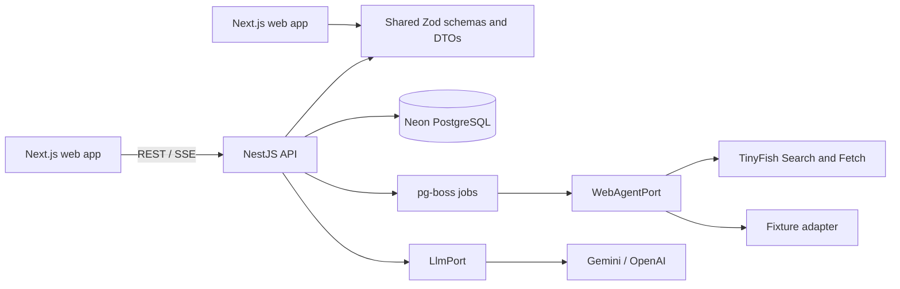

# TenderGuard AI architecture

## Current phase: 7 — product MVP and hardening

This repository expands the TinyFish workshop starter into TenderGuard AI. The original Python workshop examples remain preserved.

Neon PostgreSQL stores profiles, jobs, public tender text, evidence, verdicts, watches, snapshots, alerts, and audit logs. Prisma uses the pooled `DATABASE_URL` for application queries and `DATABASE_URL_UNPOOLED` for migrations. The long-lived pg-boss worker uses the direct URL to support its queue session and advisory-lock behavior. Fixture and TinyFish adapters implement the same port. Gemini and OpenAI adapters implement the extraction port. Fixture mode is intended for demos; live mode is restricted to public portal URLs and stops on CAPTCHA or login walls.

## Local services

- Web: `http://localhost:3000`
- API health: `http://localhost:4000/api/health`
- Local PostgreSQL (optional): `localhost:5432` (database/user `tenderguard`, development-only password `tenderguard_dev`)
- Neon setup: run `neon deploy`; it writes pooled and direct connection variables into the root `.env` (or `.env.local`). Keep both files out of version control.
- Mailpit: `http://localhost:8025` (local email preview)

Use `.env.example` as the safe template. Do not put provider credentials in committed files.

## UI design integration

Stitch MCP generated dashboard and evidence-detail reference screens. The detail screenshot is in [design-reference/tender-detail.png](design-reference/tender-detail.png); palette and screen references are documented in [ui-design.md](ui-design.md). The generated reference included invented tender facts, so it is used only for visual hierarchy and spacing. Product evidence must come from verified source text or be labeled unknown.

## Operational boundaries

- Searches are capped at ten tenders and process at most five concurrently.
- TinyFish access is isolated behind `WebAgentPort`; outbound tender URLs are restricted to HTTPS on CPPP/GeM hosts.
- Public page fetches never solve CAPTCHAs, authenticate, or submit bids.
- Verdicts use deterministic templates and verified clause quotes. Provider output never sets a verdict directly.
- A reachable PostgreSQL database is required for the API, queue, migration, and seed. Local Docker Postgres remains an optional development alternative to Neon.
