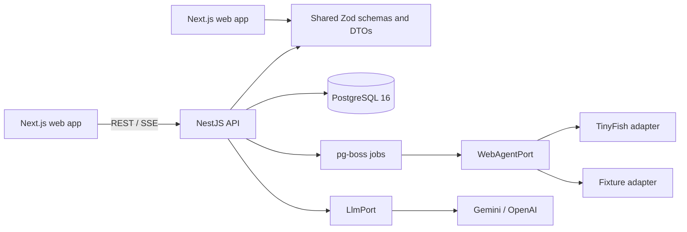

# TenderGuard AI architecture

## Current phase: 0 — scaffold

This repository is being expanded from the TinyFish workshop starter into the TenderGuard AI pnpm monorepo. The original Python workshop examples are retained while the new app is scaffolded.

The diagram records the intended architecture. Only the workspace shell, shared environment validation, web shell, API health endpoint, and local PostgreSQL service exist in Phase 0. Later phases add the ports, adapters, database model, and product flows.

## Local services

- Web: `http://localhost:3000`
- API health: `http://localhost:4000/api/health`
- PostgreSQL: `localhost:5432` (database/user `tenderguard`, development-only password `tenderguard_dev`)

Use `.env.example` as the safe template. Do not put provider credentials in committed files.

## UI design integration

The requested Stitch MCP endpoint is `https://stitch.googleapis.com/mcp`. No Stitch connector/tool is currently exposed to this session, so no Stitch-generated screen has been produced yet. The product UI should follow the brief's indigo/teal palette, evidence-first hierarchy, responsive layout, and explicit responsible-AI notice. Connect Stitch before Phase 4 to generate and refine the screens.
